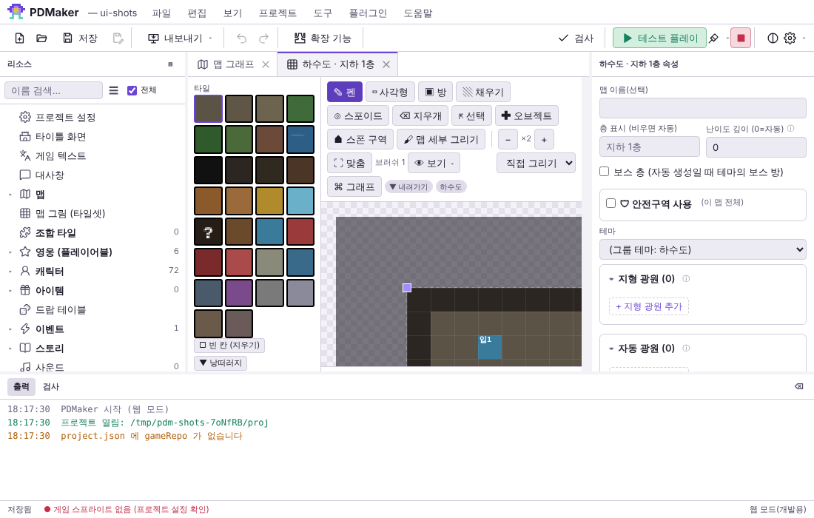
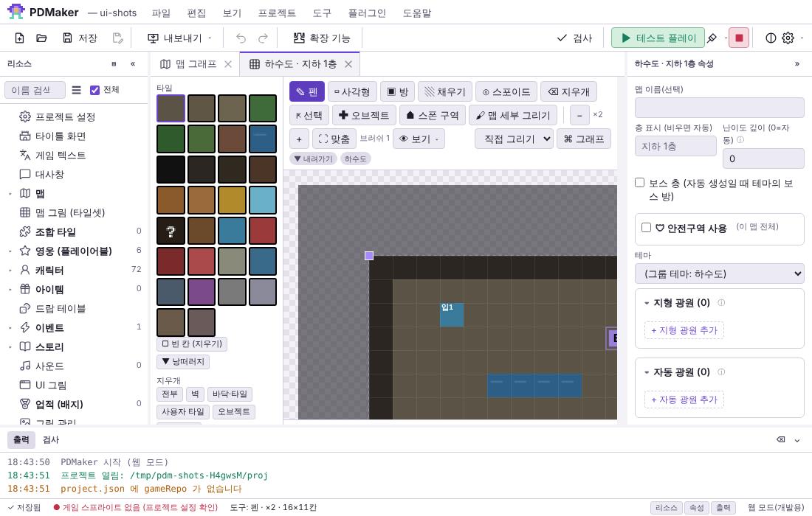
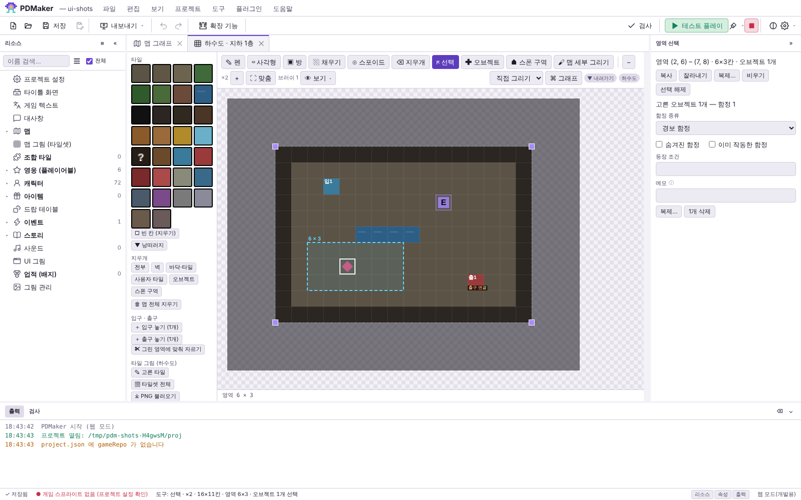
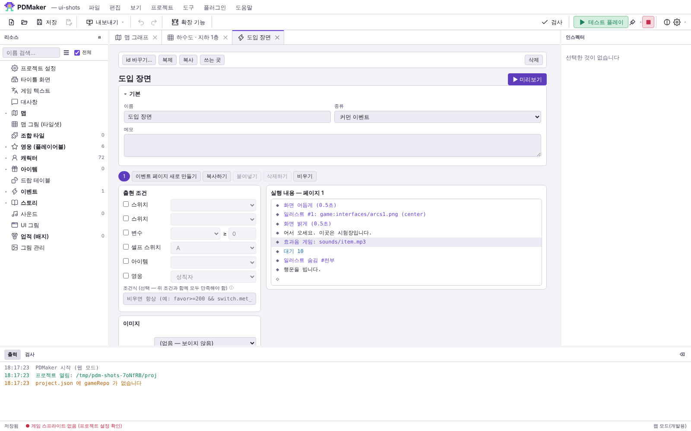
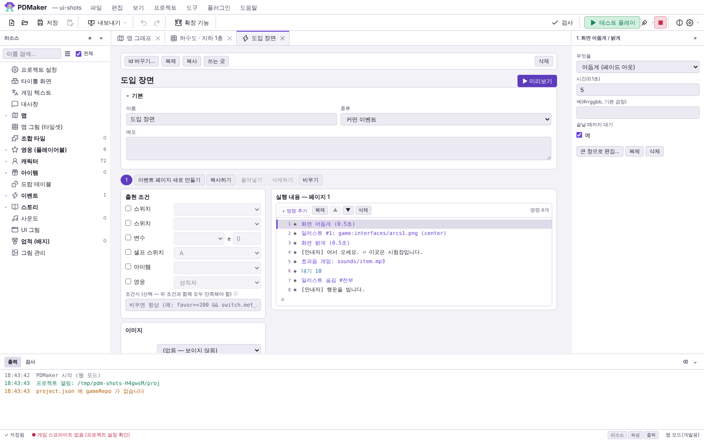
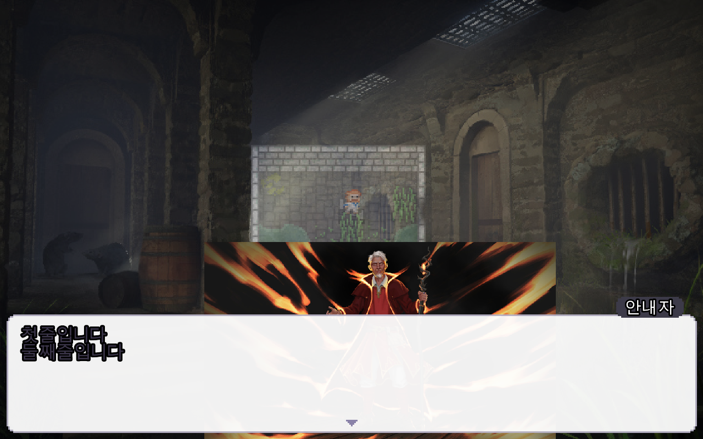
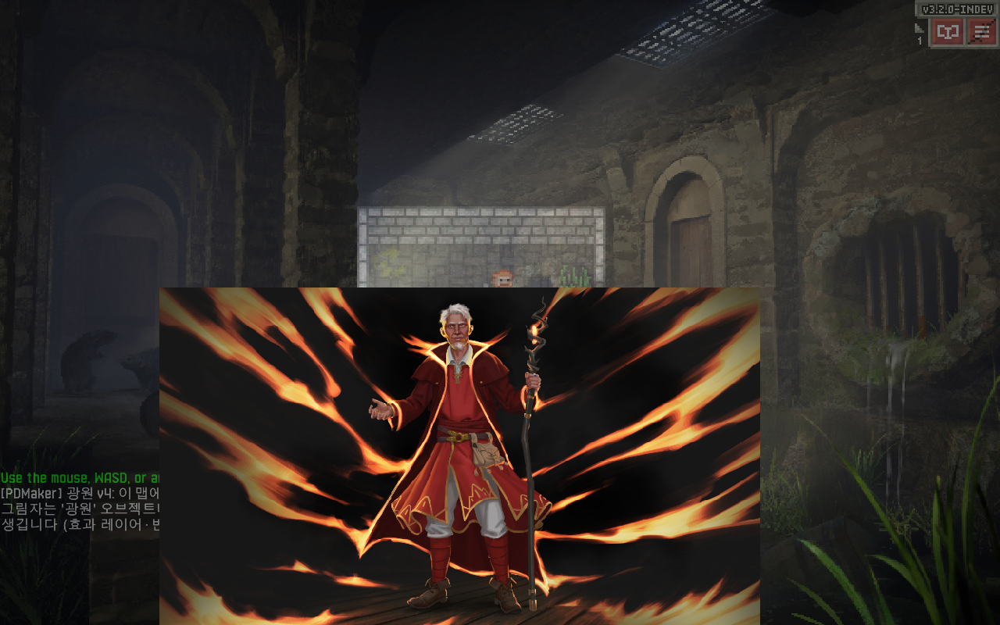

# 3차 작업: 편집기 UI/UX 개선 · 이벤트 연출 (2026-10-17)

시작 상태: 브랜치 `claude/modest-rubin-k9akxp` HEAD `f856edf`(2차 커밋 = 원격과 같음), 작업 트리 깨끗.
기준선(실제 실행): `node tools/tests/run.js` **29 통과** · `NODE_PATH=$(npm root -g) node tools/tests/ui-map.js` **14 통과**.

**먼저 밝혀 둘 것** — 조사해 보니 이벤트 · 연출 시스템은 이미 대부분 있었습니다(`events/<id>.json` · 명령 64종 · 런타임 `EventInterpreter` · RPG Maker 식 대사창 `MakerDialogue` · 일러스트 층 `MakerStage` · 페이드 · 흔들림 · 번쩍임 · 소리 · 조건 분기 · 스위치 · 변수 · 장면 미리보기). 디자인 시스템(토큰 · 컴포넌트 · 아이콘 · 견본 `styleguide.html`)도 이미 있었습니다. 그래서 이번 작업은 전면 재작성이 아니라 **실제 화면 · 실제 게임에서 확인한 빈틈을 메우는 것**으로 범위를 잡았습니다. 아래 "새로" 와 "원래 있음" 을 구분해 적습니다.

## 1. 기존 UI/UX 의 주요 문제와 근거

개선 전 화면은 `tools/tests/ui-shots.js` 로 웹 모드 편집기를 실제로 띄워 찍었습니다(`docs/images/ux3/*-before.png`).

| 문제 | 근거 (실제 화면 · 코드) | 처리 |
|---|---|---|
| 좁은 창에서 맵 캔버스가 거의 안 보임 | 1000×640 창에서 맵 보기 영역 **252×98px** (UI 테스트 측정). 출력 창이 기본 170px · 최소 60px 로 늘 열려 있고(`#app` 격자), 리소스 250 + 속성 300px 고정 | 패널 접기 · 좁은/낮은 창 기본 크기 줄임 → 기본 **352×236px**, 패널을 접으면 **556×400px** |
| 패널을 접을 수 없고 크기를 기억하지 않음 | `splitters()` 는 끌기만, 저장 없음 | 접기(버튼 · 단축키 · 메뉴) · 크기 · 상태 기억 |
| 이벤트 편집기 오른쪽 속성 창이 늘 "선택한 것이 없습니다" | 명령은 더블클릭 → 큰 창으로만 고침 (`commands.js editCommandModal`). 300px 를 비워 둠 | 명령을 누르면 속성 창에서 바로 고침 |
| 명령 목록: 실행 순서 번호 · 빈 값 표시 없음, 명령 추가는 ◇ 줄 더블클릭만 | 화면 · 코드 | 번호 · ⚠ · 도구 줄 · 찾기 |
| 탭을 다시 그리면 고른 명령이 풀림 | `PDM.commandList` 의 `sel` 이 지역 변수 — 편집 · 실행 취소 때마다 사라짐 | 목록마다 기억 |
| 맵 편집기의 지금 도구 · 레이어 · 확대 · 선택을 한눈에 못 봄 | 확대는 도구 줄의 작은 "×2", 영역 크기는 캔버스 아래 줄에만 | 상태 줄에 한 줄로 |
| 저장 중 · 저장 실패가 상태 줄에 안 보임 | `updateStatus` 는 "저장됨 / 저장 안 된 변경 있음" 둘뿐, 실패는 알림이 잠깐 | 저장 중 · 실패(누르면 다시 저장) · 안 된 개수 |
| **화면 어둡게(fade)가 일러스트를 덮을 때도 있고 아닐 때도 있음** (런타임 버그) | 게임 화면 캡처: 페이드 뒤에 연 일러스트가 검은 화면 위에 그려짐 — 일러스트 층을 만든 순서에 따라 달라짐. 편집기 미리보기는 늘 덮음 | 늘 덮게(미리보기 · RPG Maker 와 같음) — §6 |
| 일러스트에 크기 · 불투명도 · 옮기기 · 움직이기 · "나타날 때까지 대기"가 없음, 입력 기다리기 · 대사별 글자 속도 · 저절로 넘기기 · 배경음 끄기(페이드) 없음 | `schema.js` 명령 정의 · `MakerStage` (번호 · 그림 · 위치 · 페이드만) | 런타임 + 편집기 + 미리보기 — §4 |
| 미리보기와 게임의 일러스트 자리가 다른 계산 | 미리보기는 CSS(`left: 4%` · `max-height: 92%`), 게임은 `MakerStage` 식 | 같은 식 하나(`PDM.Dialogue.stageLayout`) + 테스트 |

질문에 대한 답(개선 후): 처음 쓰는 사람도 상태 줄에서 지금 도구 · 선택 · 저장 상태를 봄 / 속성 편집과 맵 작업: 오른쪽 속성 창이 고른 것(맵 오브젝트 · 영역 · 이벤트 명령)을 바로 보여 줌 / 공간: 쓰지 않는 패널은 접어 둘 수 있고 기억됨 / 숙련자: Ctrl+B · Ctrl+Shift+B · Ctrl+J, 명령 목록 ↑↓ · Alt+↑↓ · Enter · Delete, 명령 찾기 Enter.

## 2. 색 체계 · 디자인 토큰

기존 토큰(`css/app.css` 1장 — 어두운 차콜 4단계 표면 `--bg`~`--bg4`, 테두리 `--line`, 글자 `--fg` · `--mute` · `--dim`(모두 4.5:1 이상), 보라 강조 `--accent` · 선택 `--accent-soft`, 의미 색 `--good` `--warn` `--bad` `--info`, 간격 `--sp-*`, 글자 `--fs-*`, 모서리 `--r-*`, 높이 `--ctl-h*` · `--bar-h`, 모션 `--dur*`)은 이미 요구한 범주를 대부분 갖추고 있어 **바꾸지 않았습니다**(멀쩡한 체계를 취향으로 바꾸지 않음 — 기존 화면 · 테스트 · 사용자 테마 호환).

새로 더한 토큰: `--tree-w` · `--insp-w` · `--bottom-h` · `--status-h` · `--split`(셸 배치 기본값 — 좁은 창 · 낮은 창은 미디어 질의로 줄임), `--disabled-opacity`(비활성). 상태 색은 기존 의미 색만 사용(저장 중 `--info` · 실패 `--bad` · 안 됨 `--gold`). 글꼴은 시스템 글꼴(맑은 고딕 · Apple SD 고딕) 그대로 — 외부 글꼴을 내려받지 않으므로 오프라인에서도 같음.

## 3. 바뀐 화면과 조작

 

- **패널**: 리소스 «(Ctrl+B) · 속성 »(Ctrl+Shift+B) · 출력 ⌄(Ctrl+J) — 패널 제목 버튼, 상태 줄 오른쪽 "리소스 · 속성 · 출력" 버튼, 보기 메뉴. 접은 상태 · 끈 크기는 다시 켜도 그대로(이 PC 설정 `localStorage pdm.layout`). 검사(F7) · 빌드 출력은 접힌 출력 창을 펼침. 입력 칸에 글을 치는 중에는 이 단축키가 동작하지 않음.
- **상태 줄**: 왼쪽부터 저장 상태(✓ 저장됨 · ● 저장 안 됨 (n개) · ⟳ 저장 중… · ✕ 저장 실패 — 누르면 다시 저장) · 그림 경고 · 지금 편집기 상태(맵: `도구: 선택 · ×2 · 16×11칸 · 영역 6×3 · 오브젝트 1개 선택`, 붙여넣기 중이면 그 안내) · 패널 버튼.

- **이벤트 명령 목록**: 명령을 누르면 오른쪽 속성 창 제목이 `번호. 명령 이름` 이 되고 칸을 바로 고침(0.4초 모아 한 번 저장 = Ctrl+Z 한 번, 입력 중 초점 유지). 큰 창 편집(더블클릭 · Enter)도 그대로. 목록 위 도구 줄 "+ 명령 추가 · 복제 · ▲ · ▼ · 삭제 · 명령 n개", 줄마다 실행 순서 번호, 빈 값이 있으면 ⚠(마우스를 올리면 이유). ↑↓ 고르기 · Alt+↑↓ 옮기기. 명령 넣기 창 맨 위 찾기 칸(예: "움직" → 일러스트 움직이기, Enter = 첫 번째).

 

- 기존 단축키 · 맵 편집기 입력(2차의 영역 선택 · 여러 오브젝트 · 붙여넣기 미리보기) · 실행 취소는 그대로(테스트 §9).

## 4. 이벤트 명령 (연출)

| 명령 | 상태 | 칸 |
|---|---|---|
| 대사 표시 `text` | 원래 있음 + **새 칸** | 화자 · 표정 · 일러스트 · 위치 · 이름 · 대사(여러 줄) + **글자 속도**(`speed`: 바로 · 느리게 20 · 보통 40 · 빠르게 80 자/초, 비우면 대사창 설정) · **저절로 넘기기**(`auto`, 0.1초 — 0 = 입력을 기다림) |
| 선택지 · 조건 분기 · 반복 · 스위치 · 변수 · 셀프 스위치 · 대기 · 이벤트 중지 · 커먼 이벤트 | 원래 있음 | — |
| 일러스트 표시 `illust` | 원래 있음 + **새 칸** | 번호 1~8 · 그림 · 위치(왼쪽 · 가운데 · 오른쪽 · 전체) · 페이드 + **크기 %** · **불투명도 %** · **옮기기 x/y (화면 px)** · **좌우 뒤집기** · **나타날 때까지 대기**. 같은 번호에 다시 표시 = 교체(앞 그림은 페이드 아웃). 번호가 큰 그림이 앞 |
| **일러스트 움직이기** `illustMove` | **새로** | 번호 · 자리(왼쪽 · 가운데 · 오른쪽, 비우면 그대로) · 옮기기 x/y(목표) · 크기 %(0 = 그대로) · 불투명도 %(비우면 그대로) · 시간 · 끝날 때까지 대기(기본 켬) |
| 일러스트 숨김 `illustHide` | 원래 있음 | 번호(0 = 전부) · 페이드 |
| **입력 기다리기** `waitInput` | **새로** | 화면을 누르거나 확인(Enter · Space · Z) · 취소 키 |
| 화면 어둡게/밝게 `fade` · 흔들림 · 번쩍임 | 원래 있음 (**겹침 순서 고침**) | 시간 · 색 · 대기 |
| **스크린 이동 · 팔로우 · 쉐이크 · 리셋** `camMove` `camFollow` `camShake` `camReset` | **6차 새로** (묶음 "카메라 / 스크린") | 칸 · 단위 · 기본값: `docs/EDITOR-GAME-THEME-CAMERA-CUTSCENES.md` §5~9 |
| **대사 스타일** `textStyle` | 5차 새로 | 글꼴 · 출력 · 연출 탭 (`docs/EDITOR-MOBILE-TESTPLAY-DIALOGUE-AND-UI-STABILITY.md` §6) |
| 효과음/음악 `sound` | 원래 있음 + **새 종류** | 효과음 · 배경음 바꾸기 + **배경음 끄기**(`bgmStop` · 페이드 아웃 시간) |

## 5. 이벤트 데이터 형식 · 저장 위치

- 저장 위치 · 형식은 **바꾸지 않음**: `events/<id>.json` `{ id, name, pages: [{ conds, cond, trigger, commands: [{ cmd, …칸 }] }] }` (DESIGN §14.1). 새 칸은 명령 객체의 선택 속성 — 없으면 예전과 같은 동작이라 버전 변환이 필요 없음(예전 프로젝트 · 예전 런타임과 호환: 예전 런타임은 모르는 칸을 무시, 모르는 명령 `illustMove` · `waitInput` 은 로그만 남기고 건너뜀).
- 이벤트가 없는 프로젝트: 새 프로젝트 → 다시 열기 테스트에서 문제 0 · 저장할 것 0(이벤트 파일을 만들지 않음).
- 저장 안전성 · 백업 · 손상 파일 처리: 1차 정책(`store.js`)을 그대로 받음 — 손상된 `events/*.json` 은 불러오지 않고 그대로 두며 검사(F7)에 오류로 나옴(2차 테스트).
- 실행 취소: 속성 창 편집 · 도구 줄 · 큰 창 편집 모두 `store.edit`(이벤트 리소스 스냅샷) — 한 번 단위.
- **세이브 정책**: 실행 중인 이벤트는 세이브에 넣지 않음. 이벤트 중에 저장하고 불러오면 그 이벤트는 버려지고(이미 바꾼 스위치 · 변수는 남음) 화면은 깨끗한 상태로 돌아옴(검은 화면 · 일러스트 · 대사창 없음, 조작 가능) — 게임에서 확인(§9). 일러스트 층 · 페이드는 화면에만 있어 세이브되지 않음.
- **중복 실행 방지**: 한 번에 이벤트 하나 — 실행 중에 다른 이벤트가 오면 대기열(`queue`)에서 차례로. 트리거는 실행 중이면 건너뜀(`busy()`), `auto` 는 페이지마다 한 번(플래그). 창 · 타이머가 사라졌는데 이어지지 않으면 멈춤 감시가 정리(새 연출 명령도 감시 대상에 추가).

## 6. 게임에서 실제로 동작하는 연출 (헤드리스 게임으로 확인)

SPD 4.0.0 + 런타임을 javac 로 컴파일해 Xvfb 에서 실행(`tools/playtest`), 이벤트를 `eval:event:[…]` 로 돌리고 새 훅 `eval:cutinfo` 로 상태를 읽으며 화면을 찍었습니다.

| 확인한 것 | 결과 |
|---|---|
| 페이드 아웃 → 전체 화면 일러스트(불투명 60%) → 페이드 인 → 왼쪽 일러스트(크기 50%) → 두 줄 대사 | `stage=[1:sewers a=0.60 … 2:mage a=1.00 sc=0.50 …] windows=[Wnd]` |
| 대사를 넘기면 일러스트 움직이기(오른쪽 · 60%) | `2:mage … sc=0.60 x=68.2` |
| 저절로 넘기기 | "저절로"(auto 1.5초)가 입력 없이 닫히고 다음 대사로 |
| 입력 기다리기 | `windows=[WaitWnd]` → 화면 누름(실제 입력 처리기로 touch) → 다음 명령 |
| 페이드가 일러스트를 덮음 (고친 뒤) | `fade=1.00` + 일러스트 3장이 있는 상태에서 화면이 완전히 검음 |
| 효과음 · 배경음 바꾸기 · 배경음 끄기(1초 페이드) | 로그 `배경음: game:music/caves_1.ogg …` · `배경음: 1.0초 동안 줄이며 끔` · 그 뒤 플레이어 해제 (소리가 실제로 들리는지는 확인 못 함 — §10) |
| 잘못된 명령 · 없는 리소스 | 없는 효과음 · 빈 소리 · 없는 일러스트 · 그림이 없는 번호 움직이기 → 경고 로그, 이벤트는 멈추지 않고 다음 대사까지 진행 · 정상 종료 |
| 대사 중 입력 | 대사 · 입력 기다리기 동안 화면을 눌러도 영웅이 움직이지 않음(영웅 칸 그대로), 끝나면 `busy=false windows=[] stage=[] fade=none` |
| 이벤트 중 저장 → 다시 불러오기 | 저장 전 `busy=true fade=1.00 stage=[3:rogue] windows=[Wnd]` → 불러온 뒤 `busy=false fade=none stage=[] windows=[]` |
| 이벤트 둘을 연달아 | `queue=1` → 첫째가 끝난 뒤 둘째 → `queue=0`, 동시에 돌지 않음 |

## 7. 바뀐 파일 · 주요 함수

| 파일 | 내용 |
|---|---|
| `editor/renderer/index.html` · `css/app.css` | 패널 접기 버튼 · 상태 줄 칸, 셸 토큰 · 접힌 패널(격자에서 빼지 않고 크기 0) · 좁은/낮은 창 기본 크기 · 명령 목록 번호 · ⚠ · 도구 줄 |
| `js/app.js` | `PDM.panels`(접기 · 크기 기억) · `PDM.status.ctx` · 저장 상태(`saveState`) · `showBottom` 이 접힌 출력 창을 폄 · 단축키 정의 · 보기 메뉴 |
| `js/keys.js` | `toggleTree` Ctrl+B · `toggleInspector` Ctrl+Shift+B · `toggleBottom` Ctrl+J (입력 칸 안에서는 동작 안 함) |
| `js/commands.js` | `PDM.commandList`: 고른 명령 기억(`SEL`) · `showProps`(속성 창 편집) · 번호 · `PDM.commandProblems` · 도구 줄 · 키보드 · `pickCommand` 찾기 · `normBlocks` |
| `js/schema.js` | `text.speed/auto` · `illust` 새 칸 · `illustMove` · `waitInput` · `sound.kind bgmStop/fade` · 요약 글 |
| `js/editors/dialogue.js` | `PDM.Dialogue.stageLayout` · `ease` · `UI_H` (런타임과 같은 식), 미리보기의 줄별 속도 · 저절로 넘기기 |
| `js/editors/event.js` | 미리보기: 같은 자리 계산 · 움직이기 · 화면 어둡게 · 입력 기다리기 · 소리 · 없는 그림 경고 |
| `js/editors/map.js` | `updCtx`(상태 줄) |
| `js/validate.js` | 이벤트 명령의 빈 값을 검사(F7) 경고로 |
| `runtime/…/MakerStage.java` | 크기 · 불투명도 · 옮기기 · 뒤집기 · 번호 순서 · `move`(Game.elapsed 기반) · `idle` · 페이드 겹침 순서 · `debugState` |
| `runtime/…/EventInterpreter.java` | `illust` 새 칸 · `illustMove` · `waitInput` · `text.speed/auto` · `sound bgmStop` · `waitUntil`(연출이 끝날 때까지) · 멈춤 감시 대상 · `debugState` |
| `runtime/…/MakerDialogue.java` | `Line.speed/auto` · `WaitWnd` |
| `runtime/…/MakerAudio.java` | `stopBgm(sec)` (Music.fadeOut 이 없는 판은 바로 끔) |
| `tools/playtest/Hooks.java` | `cutinfo` |
| `tools/tests/run.js` · `ui-editor.js`(새) · `ui-shots.js`(새) | 테스트 · 캡처 |

## 8. 기존 기능 호환성

- 2차까지의 편집 기능(영역 · 여러 오브젝트 · 붙여넣기 미리보기 · 실행 취소)·검사·저장 안전성·백업: `ui-map.js` 14 · `run.js` 의 1·2차 테스트 모두 통과.
- 게임: 조합 자동 생성 버전 1 배치(씨앗 `PDMTEST` 10곳 좌표가 1·2차와 같음) · 조합 광원 세이브 고정(광원을 끈 뒤 이어하기 10 → 10) — 이번 빌드로 다시 확인.
- 보존 타일 번호 29종 · DungeonTileSheet 대응 · 편집기 ↔ 런타임 표: 테스트 통과.
- 일러스트: 새 칸이 없는 예전 명령은 예전 모습 그대로(크기 100% · 불투명 100% · 옮기기 0). 바뀐 점은 **페이드가 늘 일러스트를 덮는 것** 하나 — 예전엔 일러스트 층을 페이드보다 나중에 만든 경우만 일러스트가 검은 화면 위에 보였음(우연한 순서). 그런 연출을 원했다면 페이드 대신 전체 화면 검은 그림을 낮은 번호 일러스트로 쓰면 됨.
- 단축키: 기존 키는 그대로, 새 키 3개(Ctrl+B · Ctrl+Shift+B · Ctrl+J)는 기존 동작과 겹치지 않음을 키 표에서 확인. 편집 › 단축키 설정에서 바꿀 수 있음.

## 9. 테스트 (실제 실행)

| 명령 | 결과 | 범위 |
|---|---|---|
| `node tools/tests/run.js` | **33 통과 · 0 실패** (기존 29 + 새 4) | 새: 편집기 명령 64종 모두 런타임 처리 · 연출 명령이 멈춤 감시 대상 / 일러스트 자리 미리보기 = 런타임 식(4 위치 × 3 설정) · 런타임 식이 바뀌면 실패 / 명령 빈 값 ⚠ · 검사 경고 · 없는 일러스트 그림 / 연출 이벤트 저장 · 불러오기 동등 |
| `NODE_PATH=$(npm root -g) node tools/tests/ui-editor.js` | **13 통과 · 0 실패** (새) | 패널 접기(단축키 · 버튼) · 다시 열어도 기억 · F7 이 출력 창을 폄 · 입력 중 단축키 무시 · 좁은 창 · 상태 줄 · 저장 상태 · 속성 창 편집 → 초점 유지 → Ctrl+Z · 번호 · ⚠ · ↑↓ · Alt+↑ · 복제 · 명령 찾기 · 미리보기 · 탭 20번 전환 뒤 창 이벤트 수 그대로 · 페이지 오류 0 |
| `NODE_PATH=$(npm root -g) node tools/tests/ui-map.js` | **14 통과 · 0 실패** (기존) | 2차 맵 편집 기능 전부 |
| javac (SPD 4.0.0 + 런타임) | 오류 없음 | Gradle 은 이 환경에서 Android 플러그인 다운로드가 막혀 못 씀 |
| 헤드리스 게임 | §6 표 | 연출 · 입력 · 세이브 · 중복 · 오류 처리 · 자동 생성 · 광원 회귀 |

UI 테스트가 실제로 잡은 것: 처음 만든 패널 접기는 `display: none` 때문에 격자 칸이 밀려 가운데 작업 칸 너비가 **0** 이 됨 → 크기 0 · 안 보이게로 고친 뒤 통과.

**성능 (같은 조건 전후)**: 80×80 맵 · 확대 ×2 · 영역 끌기 마우스 이동 한 번 — 전 25~38ms → 후 26.7 · 27.5ms(두 번), 사각형 도구 24~28 → 25.5 · 28.2ms. 상태 줄은 도구 · 선택이 바뀔 때만 쓰고 그리기마다 쓰지 않음 — 나빠지지 않음. 보이는 칸만 그리기 같은 최적화는 하지 않음(측정 기준만 유지).

## 10. 확인하지 못한 것

- Electron 창(실제 OS 창 · 메뉴 · 시스템 클립보드) — 모든 UI 테스트는 같은 코드를 웹 모드 Chromium 으로.
- Windows · macOS · 안드로이드 빌드, 고해상도(배율 2) 화면.
- 소리가 실제로 들리는지: 헤드리스 오디오에서 음악 플레이어가 `재생 중 false` 로 보고 — 재생 호출 · 끄기 경로만 로그로 확인.
- 일러스트 움직이기 중간 프레임의 매끄러움(캡처 시점이 움직이기가 끝난 뒤였음 — 끝 값은 확인).
- 대사창 글자가 여러 페이지로 자동으로 나뉘는 기능은 없음(대사 명령을 나눠야 함 — 원래 동작).

## 11. 알려진 문제 · 후속 우선순위

1. **일러스트 위치는 세로 그림 기준**: 가로로 긴 그림을 왼쪽/오른쪽에 두면 화면 가운데쯤 오거나 화면 밖으로 나갈 수 있음(크기 기준이 화면 높이 90%). 예전 연출 모습을 바꾸지 않으려고 그대로 둠 → "화면에 맞추기" 선택 칸 추가가 다음 단계.
2. 페이드를 대사창이 떠 있는 동안 시작하면(대기 끔) 페이드가 대사창도 덮음 — 대사창이 늘 위인 것은 "새 창이 나중에 뜰 때"만.
3. 맵 편집기 그리기는 여전히 전체 다시 그리기(80×80 ×2 에서 약 26~28ms/이동).
4. 대사 페이지 자동 나누기 · 화면 흔들림 세기 곡선 · 카메라 이동/확대 명령의 미리보기(지금은 "게임에서 실행됨" 로그만).
5. Electron 창에서 같은 UI 테스트(Playwright Electron).
