# PDMaker 4차 — UI 기능 묶음 · 디자인 시스템 통일 · PC · 모바일 테스트 플레이 검증

기준: 브랜치 `claude/modest-rubin-k9akxp`, 시작 커밋 `9016dd4` (작업 트리 깨끗 · 회귀 테스트 33/33 · UI 13/13 · 맵 UI 14/14 통과 확인 후 시작).
이 문서의 모든 "확인함"은 아래 9장의 명령으로 실제 실행한 결과입니다. 실행하지 못한 것은 10장에 따로 적었습니다.

## 1. 요약 — 실제로 바뀐 것

**편집기 UI**
- 메뉴 막대에 **실행** 메뉴를 새로 둠 (테스트 플레이 · 실행 방식 · 컴파일 확인 · 빌드 정리 · 중지 — 예전엔 "프로젝트" 메뉴에 설정 · 검사 · 실행 · 내보내기가 섞여 있었음).
- 같은 일을 하는 메뉴와 도구 모음 ▾ 가 **한 목록**(`RUN_ITEMS` · `EXPORT_ITEMS` · `SETTINGS_ITEMS` · `THEME_ITEMS`)을 씀 → 이름 · 단축키 표시 · 비활성 조건이 곳마다 다르던 문제가 없어짐. "게임 파일 내보내기"가 두 메뉴에 있던 중복 · "확장 기능" 버튼이 세 곳에 있던 중복을 정리.
- 켜고 끄는 메뉴 항목 표시를 한 가지(✓ 칸)로, 묶음 제목(테마 · 강조색 · 설명문) 추가.
- 확인 창: 지우기 · 덮어쓰기는 ⚠ + 빨간 "진행" 버튼 (모든 편집기의 `PDM.ui.confirm` 이 같은 규칙). 창에 `role=dialog` · 닫기 버튼 이름.
- 알림(toast): 성공 · 주의 · 실패를 기호 + 상태 색 줄로 구분, 실패는 5초 · 화면 읽기 프로그램에 바로 알림.
- 고르는 카드(퀘스트 · 업적 · 트레일러 장면 · 조합 타일)를 공통 클래스 `.selcard` 로 — 정의되지 않은 토큰 `--acc` 를 써서 늘 보라 기본값으로 그려지던 버그도 함께 없어짐.
- 이벤트 페이지: 가운데 칸이 좁으면 "실행 내용"이 조건 아래로 내려감 (1100×700 창에서 명령 목록 230px → 570px).
- 오른쪽 패널 이름 "인스펙터"를 메뉴 · 단축키 설명과 같은 "속성"으로.

**디자인**
- 보라 기운의 바탕 · 보라 강조색 → **중성 차콜 + 청록 강조색 하나** (어두움 · 밝음 두 테마). 토큰만 바꾼 게 아니라 "주요 동작 / 선택 · 켜짐 / 포커스 / 위험 / 상태"의 역할을 나눔 (4장).
- 맵 캔버스의 선택 · 영역 표시, 파형 · 게이지 등 JS 가 직접 칠하던 보라를 토큰(`PDM.cssVar`)으로.
- 대비 · 토큰 정의를 자동 테스트로 검사.

**게임 런타임 (PC · 모바일 화면에서 실제로 발견해 고친 버그 3개 — 8장)**
1. **창 크기 · 화면 방향이 바뀌면 연출이 사라지고 이벤트가 멈춤** (PC 창 크기 조절 · 휴대폰 회전 · 분할 화면 공통) → 연출을 새 화면으로 옮기고 창을 다시 띄움.
2. **빈칸 없는 긴 대사(일본어 · 중국어 등)가 앞 글자부터 한 줄에 한 글자씩 세로로 쌓임** → 줄 배치 수정.
3. **세로 화면에서 가로로 긴 일러스트가 화면 폭의 3배 이상 · 대사창이 노치 · 내비게이션 바 아래로 들어감** → 일러스트 폭 제한 · 대사창을 안전 영역 안으로.

## 2. UI 조사 결과 — 중복 · 불일치

코드(`app.js` 메뉴 · 도구 모음, `ui.js` 창 · 메뉴, `util.js` 알림, 편집기별 파일)와 화면 캡처로 확인한 것만 적었습니다.

| 현재 위치 | 기능 목적 | 중복 · 유사 항목 | 현재 문제 | 개선 방안 | 위험 | 검증 방법 |
|---|---|---|---|---|---|---|
| 메뉴 "프로젝트" | 설정 · 검사 · 실행 · 빌드 · 내보내기 | 도구 모음 ▶ · 빌드 ▾ · ■ · 내보내기 ▾ · ⚙ ▾ | 성격이 다른 11개 항목(설정 3 · 검사 · 실행 3 · 컴파일 · 정리 · 중지 · 내보내기)이 한 메뉴에. "게임 파일 내보내기"가 파일 메뉴와 중복 | "실행" 메뉴 분리, 내보내기는 파일 메뉴에만 | 메뉴 위치를 외운 사용자 — 단축키(F5 · Shift+F5 · F7 · Ctrl+Shift+E)는 그대로 | `ui-editor.js` "메뉴 묶음" |
| 메뉴 ↔ 도구 모음 ▾ | 같은 실행 · 빌드 항목 | 두 곳에 따로 적은 목록 | 이름이 다름("▶ 테스트 플레이 — desktop:debug (INDEV 버전)" / "▶ desktop:debug 로 실행 (INDEV 버전)"), 메뉴는 실행 중에도 실행 가능 · 도구 모음은 막힘, 메뉴의 ■ 중지는 늘 켜짐 | 한 목록 함수에서 만들기 → 같은 이름 · 같은 비활성 조건 | 없음 (같은 함수 호출) | `ui-editor.js`: 도구 모음 "빌드 ▾" = 실행 메뉴 − (▶ · ■) |
| 도구 모음 "확장 기능" 버튼 | 확장 기능 켜고 끄기 | ⚙ 설정 ▾ · 프로젝트 메뉴 | 같은 일 세 곳, 도구 모음에서 가장 넓은 글자 버튼 | 단독 버튼을 빼고 ⚙ 설정 ▾ · 프로젝트 메뉴에 둠 | 버튼 위치에 익숙한 사용자 → 두 곳에서 찾을 수 있음 | `ui-editor.js` (단독 버튼 없음 · 설정 ▾ 에 있음) |
| 보기 메뉴 · 도구 모음 테마 버튼 | 테마 · 강조색 · 설명문 · 패널 | — | 테마는 글자 앞에 "✓ " 를 직접 붙이고 패널은 `checked` 칸 — 한 메뉴에 두 방식, 정렬이 어긋남. 도구 모음 테마 버튼은 `MENUS['보기']().slice(0, 7)`(순서에 기댄 잘라내기) | `THEME_ITEMS` 한 목록 · 모두 `checked` · 묶음 제목 | 없음 | `ui-editor.js` "보기 메뉴" |
| 편집 메뉴 "단축키 설정" | 단축키 | ⚙ 설정 ▾ | 편집 메뉴에 설정 항목 | ⚙ 설정 ▾ · 도구 메뉴로 (단축키 설정 창의 묶음 이름도 실행 · 프로젝트로 맞춤) | 없음 | `ui-editor.js` (설정 ▾ 항목) |
| 확인 창 `PDM.ui.confirm` (41곳) | 확인 받기 | — | 지우기 확인도 일반 확인과 같은 모양 · 같은 "확인" 버튼 | 지우기 · 덮어쓰기 글이면 ⚠ + 빨간 "진행" (옵션으로 직접 지정 가능) | 글로 판단 — 지정 옵션 `{danger}` 로 덮어씀 | `ui-editor.js` "확인 창" |
| 메뉴 항목 "삭제" · `.btn.danger` | 지우기 | — | 버튼은 hover 때만 빨강, 메뉴의 "삭제"는 일반 글자 | 평소에도 빨간 글자 | 없음 | 화면 캡처 |
| 알림 `toast(msg, kind)` (약 150곳) | 결과 알림 | — | 'ok' 와 'good' 두 이름, 성공 · 실패가 테두리 색만 다름, 실패도 2.6초 | 'good' = 'ok', 기호 + 상태 색 줄, 실패 5초 · role=alert | 없음 | `ui-editor.js` "알림" |
| 퀘스트 · 업적 · 트레일러 · 조합 타일 목록 | 고른 항목 표시 | 리소스 목록 `.tn.sel` · 명령 `.cmd.sel` | 편집기마다 인라인 style, **정의되지 않은 `var(--acc, #a58bff)`** — 테마 · 강조색을 바꿔도 늘 보라 | `.selcard(.on)` 공통 클래스 | 4개 편집기 모양이 조금 바뀜 | `run.js` "토큰이 모두 정의돼 있음" |
| 맵 레이어 줄 | 고른 레이어 | 같은 선택 규칙 | `var(--accent-bg, rgba(165,139,255,.18))` — 없는 토큰 → 늘 보라 | `--accent-soft` + 왼쪽 줄 | 없음 | 같음 |
| 켜진 도구 · 칩 · 메뉴 hover | "지금 상태" | 주요 버튼 `.btn.pri` | 셋 다 꽉 찬 보라 — 누를 버튼과 지금 상태가 구분되지 않음 | 4장 "세 상태" | 맵 도구 모양이 바뀜 | `ui-editor.js` "선택 상태 ≠ 주요 버튼" |
| 이벤트 명령 목록 색 | 명령 묶음 구분 | ⚠ 빈 값 표시 | "스토리" = 빨강(오류색), "영웅" = 주황 — ⚠ 빈 값(주황)과 같은 색 | 분류 색 `--cat-*` 따로 · 빈 값은 ⚠ + 점선 밑줄 | 없음 | `run.js` 대비 테스트(분류 색) |
| 이벤트 페이지 (좁은 창) | 조건 + 실행 내용 | — | 1100×700 에서 실행 내용이 230px — "명령 8개"가 세로로 쪼개짐 | 좁으면 아래로 | 넓은 창에서는 그대로 | `ui-editor.js` "좁은 창" |
| 오른쪽 패널 이름 | 속성 패널 | 메뉴 · 단축키 설명 "속성 패널" | 제목은 "인스펙터" | "속성" | 없음 | 화면 |
| 테스트 플레이 버튼 | 실행 | 메뉴 | `onclick: playtest` — 클릭 이벤트가 실행 방식 인자로 들어감 (안에서 문자열만 받아 동작은 같았음) | `() => playtest()` | 없음 | 코드 |

조사했지만 바꾸지 않은 것 (이유):
- 속성 편집 칸: 이벤트 명령 속성(`commands.js paramInput`) · 맵 오브젝트 속성 · 프로젝트 설정 모두 `PDM.ui.F` 의 같은 칸(`.field > .fl + 칸 + .hint`)을 이미 쓰고 있어 모양 규칙이 같음. 실행 방식(바로 저장 vs 0.4초 뒤 묶어 저장)은 입력 중 실행 취소 단위 때문에 일부러 다름.
- 모달 창 52곳: 이미 `PDM.ui.modal` 하나. 버튼 순서도 [취소][확인]로 같음 — 지우기 표시만 더함.
- 게임 콘텐츠 색(모션 예제 · 픽셀 팔레트 · 그라데이션 기본값 · 맵 오브젝트 분류 색 · 텍스트 효과 프리셋 "수상한 보라")은 편집기 UI 가 아니라 사용자가 만드는 게임의 색이라 그대로 둠.

## 3. UI 묶음 — 바뀌기 전 → 바뀐 뒤

| 기능 | 바뀌기 전 | 바뀐 뒤 | 단축키 |
|---|---|---|---|
| 테스트 플레이 · 실행 방식 · 컴파일 확인 · 빌드 정리 · 중지 | 프로젝트 메뉴 + 도구 모음 | **실행 메뉴** + 도구 모음 ▶ · 빌드 ▾ · ■ (같은 목록) | F5 · Shift+F5 그대로 |
| 게임 파일 내보내기 | 파일 메뉴 · 프로젝트 메뉴 · 도구 모음 ▾ | 파일 메뉴 · 도구 모음 내보내기 ▾ (같은 목록) | Ctrl+Shift+E 그대로 |
| 프로젝트 내보내기 · 가져오기 | 파일 메뉴 · 도구 모음 ▾ (이름이 조금 다름) | 같은 목록 | 그대로 |
| 확장 기능 | 도구 모음 버튼 · ⚙ ▾ · 프로젝트 메뉴 | ⚙ 설정 ▾ · 프로젝트 메뉴 | — |
| 프로젝트 설정 · build.gradle | 프로젝트 메뉴 · ⚙ ▾ | 같은 목록 | — |
| 검사 | 프로젝트 메뉴("검사 (끊어진 참조 찾기)") · 도구 모음(설명 "끊어진 참조·빠진 그림 찾기") | 같은 이름 "검사 — 끊어진 참조 · 빠진 그림 · 소리 찾기" | F7 그대로 |
| 단축키 설정 | 편집 메뉴 · ⚙ ▾ | 도구 메뉴 · ⚙ ▾ | (기본 키 없음 — 사용자가 정한 키는 그대로) |
| 테마 · 강조색 · 설명문 · 패널 | 보기 메뉴(✓ 두 방식) · 테마 버튼(잘라낸 목록) | 보기 메뉴(묶음 제목 + ✓ 한 방식) · 테마 버튼(`THEME_ITEMS`) | Ctrl+B · Ctrl+Shift+B · Ctrl+J 그대로 |

메뉴 막대: 파일 · 편집 · 보기 · 프로젝트 · **실행** · 도구 · 플러그인 · 도움말.
도구 모음 묶음(`role=group` + 이름): 파일 | 내보내기 | 편집 ··· 검사 | 실행 | 보기 · 설정.
모든 기존 단축키는 `keys.js` 정의를 바꾸지 않았고, 기존 UI 테스트(패널 단축키 · 입력 칸 안 단축키 막힘 · F7)가 그대로 통과합니다.

## 4. 디자인 시스템

토큰 표 · 역할 대응표 · 컴포넌트 규칙: `docs/UI-DESIGN-SYSTEM.md` §2 · §3.

**팔레트 (어두움 / 밝음)**

| 역할 | 어두움 | 밝음 |
|---|---|---|
| 작업 공간 `--bg` | `#131518` | `#f1f3f5` |
| 패널 `--bg2` | `#1a1d21` | `#ffffff` |
| 입력 칸 · 컨트롤 `--bg3` | `#23272c` | `#eef0f3` |
| 테두리 `--line` / 강한 테두리 | `#2f343b` / `#454c56` | `#d6dbe0` / `#b5bdc6` |
| 글자 `--fg` · `--mute` · `--dim` | `#e3e6ea` · `#a4acb6` · `#8b949e` | `#1b1f24` · `#47505a` · `#5f6873` |
| 강조 `--accent` | `#3cc2b1` (청록) | `#0b7468` |
| 성공 · 주의 · 오류 · 정보 | `#6cc779` · `#eba552` · `#f2737f` · `#6ea8ec` | `#237a3a` · `#9a5208` · `#c0303f` · `#1f68b0` |

이전: 바탕 `#17151d`(보라 기운) · 강조 `#a58bff`(보라) / 밝음 강조 `#6a45d6`.

**역할 나누기**
- 주요 동작(`.btn.pri`)만 꽉 찬 강조색. 켜진 도구 · 칩 · 메뉴 hover · 고른 카드는 옅은 강조 바탕 + 강조색 **줄**(아래 · 왼쪽) — 색만으로 구분하지 않음.
- 포커스: `:focus-visible` 2px 고리(`--focus-ring`), 입력 칸은 강조 테두리 + 옅은 고리.
- 위험: 빨간 글자(평소) → 빨간 바탕(hover), 확인 창 ⚠.
- 상태 색은 상태에만. 이벤트 명령 분류는 `--cat-1~6`.
- 맵 위 표시 `--map-sel`(밝은 청록) · `--map-area`(하늘색) — 땅 · 물 · 벽 타일 색과 섞이지 않는 밝은 색.
- 게임 안 대사창 · 일러스트는 편집기 색을 쓰지 않음(프로젝트의 대사창 설정 그대로).

**대비 (자동 계산 · `run.js`)**: 두 테마 모두 본문 · 보조 · 설명 글자, 강조 · 상태 · 분류 색이 작업 공간 · 패널 · 입력 칸 바탕에서 4.5:1 이상. 가장 낮은 값(입력 칸 바탕 기준): 밝음 `--cat-4` 4.57 · `--cat-2` 4.69 · `--good` 4.70, 어두움 `--dim` 4.88. 밝은 테마의 강조색 · 주의 · 금색은 처음 고른 값이 4.3~4.5 라 테스트가 잡아 더 어둡게 고침. 주요 버튼 흰 글자 6.8:1(어두움) · 6.4:1(밝음).

**화면 비교 (같은 창 크기 · 같은 프로젝트 · `ui-shots.js` — 바뀌기 전은 `9016dd4` 를 git worktree 로 꺼내 같은 스크립트로 촬영)**

| 화면 | 바뀌기 전 | 바뀐 뒤 |
|---|---|---|
| 이벤트 편집 (1100×700, 어두움) | 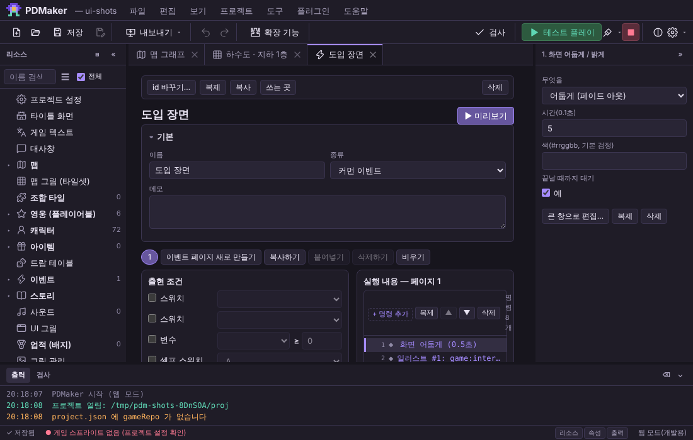 | 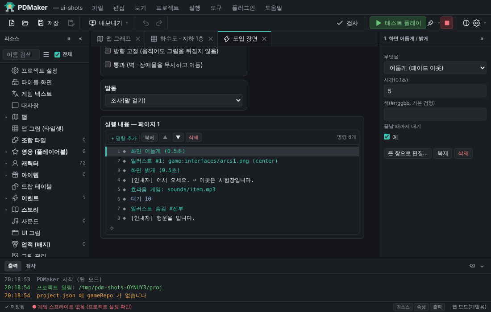 |
| 맵 편집 · 영역 선택 (1100×700, 밝음) | 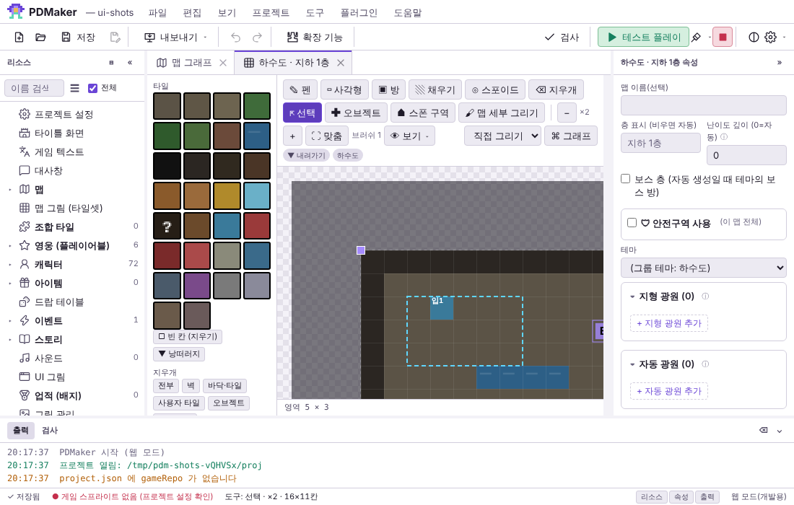 | 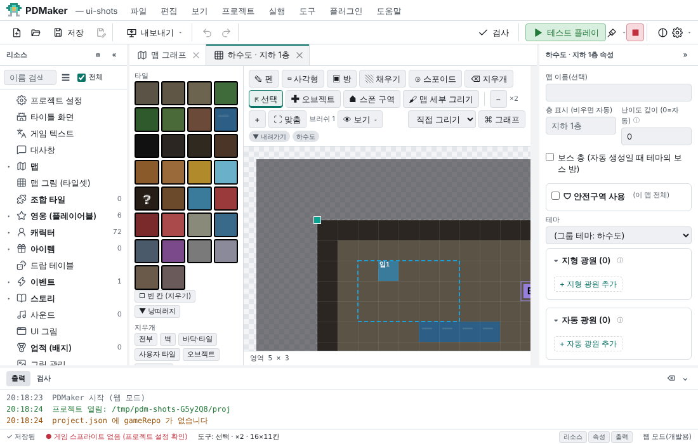 |
| 시작 화면 (1600×1000, 어두움) | 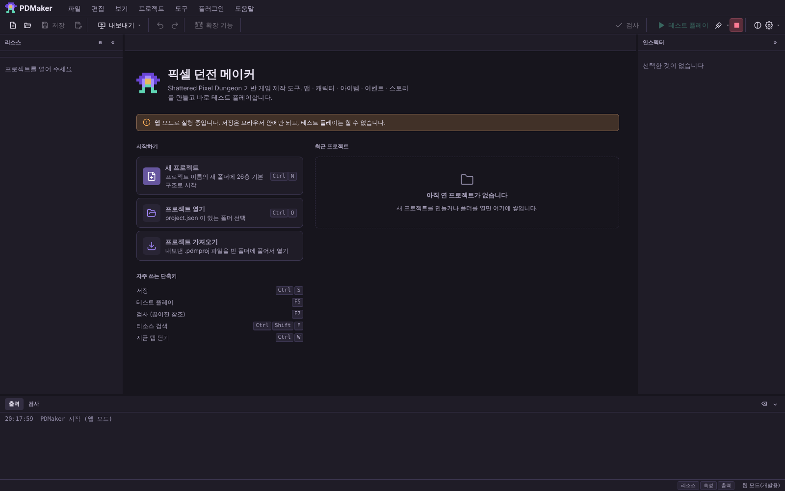 | 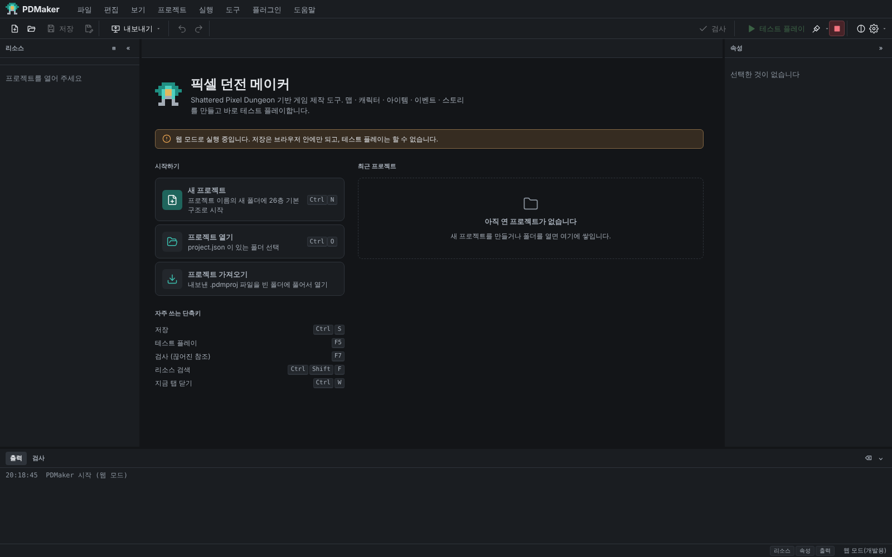 |

## 5. PC 테스트 플레이

**실행 경로 조사**
- 에디터 ▶ 테스트 플레이(`app.js playtest` → 저장 · 검사 → Electron `pdm.runGame('play')`) = 게임 저장소의 Gradle `desktop:debug`(또는 PDMaker 테스트 실행) — LWJGL3 데스크톱 판. 웹 모드는 게임을 실행하지 못함(메뉴에 이유 표시).
- 게임 = SPD(libGDX · noosa) 4.0.0 계열 + PDMaker 런타임(`runtime/…/pdmaker`, 설치기가 게임 저장소에 복사). 화면 크기: `Game.width/height` → `PixelScene` 이 화면 배율(defaultZoom)과 `uiCamera`(UI 좌표, 대략 화면 ÷ 배율)를 정함. 가로/세로 배치는 `PixelScene.landscape()` = `인터페이스 크기 > 0 || 가로 > 세로`. 데스크톱 판 기본 인터페이스 크기는 "큰 UI"라 창을 세로로 세워도 가로 배치.
- 창 크기가 바뀌면 `Game.resize` → 같은 장면을 다시 만듦(`resetScene`) → 인자 없이 만들 수 있는 창만 되살림(`restoreWindows`). 안전 영역은 `Game.platform.getSafeInsets(…)` (데스크톱 = 0, 안드로이드 = 노치 · 바).
- 입력: 데스크톱 = 마우스 · 키보드 → noosa `PointerEvent` · `KeyEvent`. 안드로이드 = 터치 → 같은 `PointerEvent`. 대사창은 화면 전체 `PointerArea`(누르면 한 줄) + 확인 · 취소 키, 입력 기다리기는 보이지 않는 화면 전체 창.

**환경**: Linux 컨테이너 · Java 17 · Xvfb(1800×1800 가상 화면) · Mesa 소프트웨어 렌더링 · `javac` 로 컴파일한 SPD 4.0.0 데스크톱 판 + 이번 런타임. 그림 · 소리는 게임 저장소의 실제 파일. Gradle 은 이 환경에서 안드로이드 플러그인을 받지 못해(403) 쓰지 못함 → 에디터의 ▶ 버튼 경로(Electron → Gradle) 자체는 실행하지 않음.

**시나리오** (`tools/playtest/scenarios.js`, 환경마다 같은 이벤트): 새 게임 → 맵 → 이벤트 실행: 페이드 아웃(0.4초) → 전체 화면 일러스트(불투명 60%) → 페이드 인 → 왼쪽 일러스트 → 긴 한국어 대사(두 줄) → 일러스트를 오른쪽으로 움직이기 → **빈칸 없는 긴 일본어 대사** → 저절로 넘어가는 대사 → 입력 기다리기(실제 입력 처리기로 화면 누름) → 효과음 → 일러스트 숨김 → 마지막 대사 → 끝. 단계마다 상태(`cutinfo`) · 배치 검사(`layout` — 대사창 · 글 · 이름표 · ▼ · 선택지 · 일러스트가 화면 · 안전 영역 밖인지, 글이 대사창을 넘는지) · 창 캡처.

| 환경 | 창(화면 px) | UI 좌표 | 결과 |
|---|---|---|---|
| PC | 1280×800 | 427×267 (배율 3) | 연출 전 단계 진행 · 배치 문제 0 · 끝난 뒤 `busy=false` · 창 없음 · 영웅 칸 그대로 |
| PC 좁은 창 | 960×600 | 480×300 | 같음 |
| PC 창 크기 조절 (대사 중 1280×800 → 800×1280 → 입력 기다리는 중 다시 1280×800) | | | **고치기 전: 대사창 · 일러스트 · 입력 기다리기가 사라지고 `busy=true` 인 채 멈춤** → 고친 뒤: 대사 · 일러스트 2장 · 입력 기다리기를 새 크기로 다시 띄우고 끝까지 진행 |
| PC 페이드 도중 창 크기 조절 (10초 페이드) | | | 고친 뒤: 페이드 0.25 → (크기 바뀜, 진행 중 1개 옮김) → 0.65 → 1.00 → 3초 대기 → 대사 → 끝 |
| 회귀 (예전 동작) | 1280×800 | | 이벤트 둘 = 차례로(대기열) · 한 번 누르면 한 줄 · 대사 중 맵을 눌러도 영웅 안 움직임 · 이벤트 중 저장 → 불러오기 = `busy=false` · 페이드 · 일러스트 · 창 없음 (9장) |

키보드: 대사 넘기기(확인 · Space · Z · Esc)는 3차에서 확인한 코드 그대로(바꾸지 않음) — 이번에는 `adv`(같은 함수) · 마우스 입력(`touch`)으로 진행.
저장 · 불러오기: 회귀 시나리오.
사운드: 효과음 명령 실행 · 오류 없음까지만 (귀로 듣지 못함 — 10장).

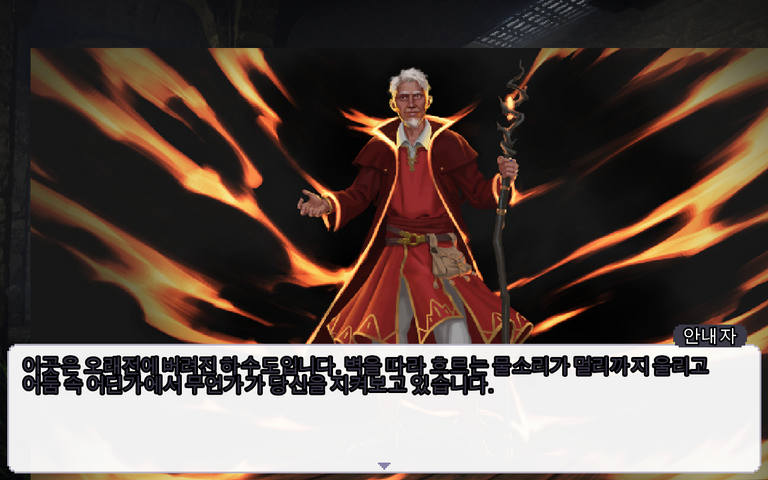

## 6. 모바일 가로 모드

**환경**: 실제 휴대폰 · 에뮬레이터가 **없음** — 컨테이너에 Android SDK 가 없고 KVM(하드웨어 가상화)도 없어 에뮬레이터를 띄울 수 없음. 그래서 **데스크톱(LWJGL3) 판을 휴대폰 비율의 창**(1170×540 ≈ 19.5:9, 인터페이스 크기 0 = 휴대폰 기본)으로 띄워 배치 · 연출 · 입력 흐름을 확인했습니다. 이것은 **화면 비율 · 배치 검증이지 안드로이드 실행 검증이 아닙니다** (화면 밀도 · 실제 터치 · 일시정지/재개 · 소리 장치가 다름).

| 환경 | 결과 |
|---|---|
| 1170×540 (UI 585×270) | 배치 문제 0 · 연출 끝까지 · 대사 두 줄 · 일본어 줄바꿈 정상 |
| + 안전 영역(왼 · 오른 90px 노치 · 아래 48px 바) | **고치기 전: 대사창 · 글 · 이름표가 안전 영역 침범 3건** → 고친 뒤 0 (대사창 49~536 × 176~242, 안전 영역 45~540 × 0~246 안) |
| + 대사 중 세로로 돌림 → 입력 기다리는 중 다시 가로 | 고친 뒤: 두 번 모두 연출을 옮김 · 끝까지 진행 · 배치 문제 0 |

터치: 데스크톱 판의 입력 처리기에 누르기 · 떼기를 보냄(`touch`) — 안드로이드 터치와 같은 `PointerEvent` 경로이지만 실제 손가락 터치(여러 손가락 · 길게 누르기 · 화면 가장자리 제스처)는 확인하지 못함.

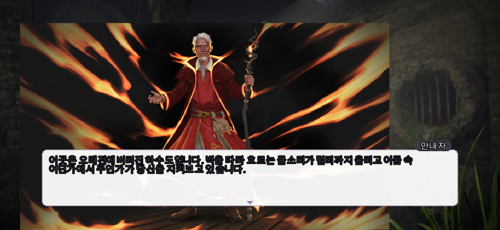

## 7. 모바일 세로 모드

**지원 여부**: 게임(SPD)은 세로 화면을 공식 지원(안드로이드 기본 방향 · 세로 배치 UI). PDMaker 런타임도 막지 않음 → 지원 대상으로 검사했습니다. 환경은 6장과 같은 제약(데스크톱 판 창 540×1170 · 인터페이스 크기 0 → `landscape=false`).

| 환경 | 결과 |
|---|---|
| 540×1170 (UI 270×585) | **고치기 전: 가로로 긴 일러스트(16:9)가 폭 936 / 화면 270 — 절반 넘게 화면 밖(배치 문제 3건)** → 고친 뒤 0 (일러스트 폭 270 · 화면 안), 대사창 262×158 · 긴 대사 4줄이 창 안 |
| + 안전 영역(위 96px · 아래 72px) | 고치기 전: 대사창이 아래 바 침범 → 고친 뒤 0 (대사창 아래 끝 545 ≤ 안전 영역 549) |
| 가로 ↔ 세로 돌림 | 6장과 같음 (양쪽으로 돌려 확인) |

세로 화면에서 대사창이 화면 높이의 27%(158px)를 차지해 긴 대사도 다 들어가고, 일러스트는 대사창 위에 섬. 세로 화면에서 맵 · 게임 UI 배치는 원작 SPD 의 세로 배치 그대로(이번에 바꾸지 않음).

| 바뀌기 전 | 바뀐 뒤 |
|---|---|
| 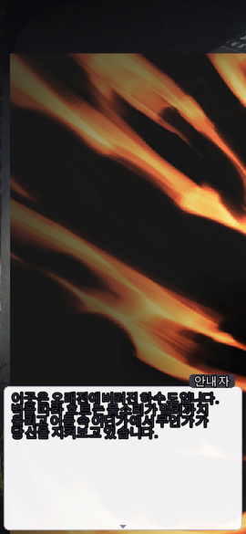 | 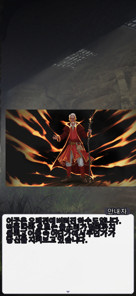 |

화면 돌림 (대사 중 가로 → 세로) — 바뀌기 전: 대사창 · 일러스트가 사라짐 / 바뀐 뒤: 새 크기로 다시 놓임

| 바뀌기 전 | 바뀐 뒤 |
|---|---|
| 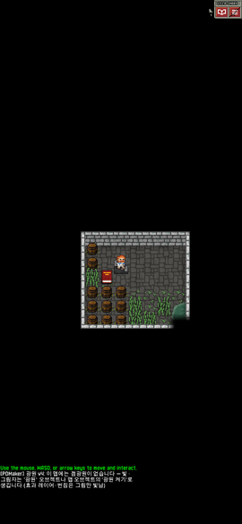 |  |

빈칸 없는 일본어 대사 (1800×1800 창에서 확인) — 바뀌기 전: 앞 글자가 세로로 쌓임 / 바뀐 뒤: 3줄

| 바뀌기 전 | 바뀐 뒤 |
|---|---|
| 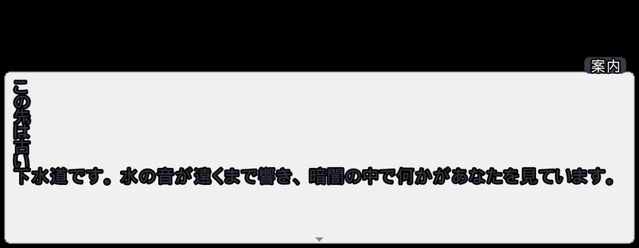 | 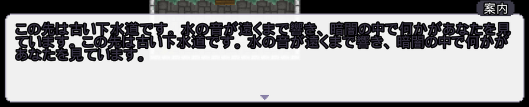 |

## 8. 발견한 버그 · 원인 · 수정

| # | 증상 · 재현 | 원인 | 수정 | 확인 |
|---|---|---|---|---|
| 1 | **창 크기가 바뀌면 연출이 사라지고 이벤트가 멈춤.** 대사 · 입력 기다리기 · 페이드 · 대기 중에 PC 창 크기를 바꾸거나 휴대폰을 돌리면 대사창 · 일러스트 · 페이드가 없어지고 `busy=true` 가 남음 (다음 트리거가 "멈춘 이벤트"로 정리하기 전까지 이벤트가 이어지지 않음 · 남은 연출 명령은 건너뜀) | `Game.resize` 가 같은 장면을 새로 만들고 인자 없는 창만 되살림. PDMaker 대사창(`Wnd(line, …)`) · 입력 기다리기 · 타이머 · 페이드 · 일러스트 층은 옛 장면과 함께 사라짐 | `EventInterpreter.sceneCreated/rebuild`: 같은 층의 게임 화면이 다시 만들어지면 이벤트가 붙인 진행(`attach` — 타이머 · 대기 · 이동 · 페이드)을 새 화면으로 옮기고, 페이드 판을 새 크기로, `MakerStage.rebuild` 로 일러스트를 같은 번호 · 자리 · 크기 · 불투명도로, 기다리던 창을 같은 내용으로 다시 띄움. 옮기는 동안 멈춤 감시가 정리하지 않게(`rebuilding`). 층이 바뀐 경우는 예전 그대로 | `pc-rot` · `phone-land-rot` · `pc-rotfade` |
| 2 | **빈칸 없는 긴 대사가 세로로 쌓임.** 일본어 · 중국어처럼 빈칸 없는 대사가 대사창 폭보다 길면 앞 글자들이 한 줄에 한 글자씩 → 글이 대사창 밖으로 넘침 (1280×800 에서 글 높이 1124px / 대사창 72px) | 글자가 하나씩 나오는 대사는 글자마다 낱말로 나누는데, 원작 줄 배치는 게임 언어가 중국어 · 일본어가 아니면 빈칸까지를 한 낱말로 묶어 "다음 줄에 다 들어가는가"로 판단 → 한 줄보다 긴 낱말이면 들어갈 때까지 한 글자씩 줄을 바꿈 | `TypeText.layout`: 원작과 같은 규칙 + 한 줄보다 긴 낱말은 글자 단위로 · 한자 · 가나 · 전각 부호는 어디서든 줄바꿈. 빈칸이 있는 한국어 · 영어는 원작과 같은 자리 | 같은 대사가 3줄로 정상 (캡처) · 모든 환경 배치 문제 0 |
| 3 | **세로 화면 일러스트가 화면 밖.** 540×1170 에서 16:9 일러스트가 폭 936 → 가운데 · 오른쪽 자리면 대부분 안 보임 | 일러스트 크기 = 화면 높이 90% 기준만 — 세로 화면 · 가로로 긴 그림을 생각하지 않음 | 기본 크기를 "높이 90% · 단 폭 ≤ 화면 폭"으로, 폭 때문에 줄어든 그림은 화면 세로 가운데에 (아래에 붙이면 대사창에 다 가려짐 — 고친 뒤 캡처로 발견해 함께 고침). `MakerStage.show` · 대사 일러스트 · 편집기 미리보기 `stageLayout` 같은 식, 테스트로 일치 확인. 가로 화면 · 세로로 긴 그림은 예전과 같음 | `phone-port` 배치 문제 3 → 0 |
| 4 | **대사창이 안전 영역(노치 · 상태 줄 · 내비게이션 바) 침범** | 대사창 · 글 · 이름표 · 선택지가 화면 전체 기준. 또 원작 `Window` 가 화면 전체 창을 안전 영역 가운데로 옮겨 위아래 바 크기가 다르면 창이 반만큼 밀림 | 안전 영역(`getSafeInsets(INSET_ALL)`) 안에 배치 · 대사창 레이아웃 비율도 안전 영역 기준 · 화면 전체 창은 화면 (0,0) 에 고정(`pinToScreen`) · 입력 기다리기 창도 가방 창 옆으로 밀리지 않게 | `*-insets` 배치 문제 3 → 0 |
| 5 | (편집기) 고르는 카드 · 맵 레이어가 테마 · 강조색과 상관없이 늘 보라 | 정의되지 않은 토큰 `--acc` · `--accent-bg` 의 기본값 | `.selcard` · `--accent-soft` | `run.js` 토큰 검사 |
| 6 | (편집기) 좁은 창에서 이벤트 실행 내용이 230px | 고정 330px 왼쪽 칸 + 가로 배치 | 좁으면 아래로 | `ui-editor.js` |
| 7 | (편집기) 웹 모드에서 ■ 중지 버튼이 늘 빨갛게 켜짐 | 비활성 조건 `!running && isElectron` | 실행 중일 때만 (Shift+F5 는 그대로) | 화면 |

화면 캡처 중 "맵을 끌면 옆 패널 글자가 선택됨"처럼 보인 것은 캡처 스크립트가 맵 아래 좌표 줄에서 끌기를 시작한 탓이었음(캔버스에서 시작한 끌기 · 맵 밖으로 끝난 끌기 모두 글자 선택 0 — 직접 확인). 버그가 아니라 고치지 않고 스크립트를 고침.

## 9. 테스트 결과 (실제 실행)

| 명령 | 결과 |
|---|---|
| `node tools/tests/run.js` | **35 통과 · 0 실패** (새: 색 대비 · 토큰 정의, 일러스트 자리 테스트를 세로 화면 · 가로로 긴 그림까지 넓힘) |
| `NODE_PATH=$(npm root -g) node tools/tests/ui-editor.js` | **19 통과 · 0 실패** (새 6: 메뉴 묶음 · 보기 메뉴 ✓ · 확인 창 · 알림 · 선택 ≠ 주요 버튼 · 좁은 창 이벤트) |
| `NODE_PATH=$(npm root -g) node tools/tests/ui-map.js` | **14 통과 · 0 실패** |
| `NOMP3=1 JARS=… tools/playtest/build.sh <SPD 4.0.0> <작업> <프로젝트>` | 컴파일 성공 |
| `JARS=… tools/playtest/platform-matrix.sh <작업> <프로젝트> pc pc-narrow phone-land phone-port phone-land-insets phone-port-insets phone-land-rot pc-rot pc-rotfade regress` | **10 환경 모두 통과** — 배치 문제 0 · 이벤트 끝남(`busy=false` · 창 없음) · 돌림 환경은 연출 옮김 기록. (같은 명령을 고치기 전 런타임으로 돌린 기록: `phone-port` 배치 문제 3 · `*-insets` 3 · `*-rot` 은 돌린 뒤 `windows=[]` 인 채 `busy=true`.) |

회귀 시나리오(`regress`) 내용: `A1 → (한 번 누름) → A2 → B1`(둘째 이벤트는 `queue=1` 로 기다렸다가) · 세 번 누르는 동안 영웅 칸 180 그대로 · 이벤트 중(`fade=1.00` · 일러스트 · 대사창) 저장 → 불러오기 → `busy=false fade=none stage=[] windows=[]` · 영웅 그대로. 조합 타일 광원 보존 · 자동 생성 버전 2 · 저장 안전성은 런타임 · 편집기 코드를 이번에 건드리지 않았고 `run.js` 의 해당 테스트(저장 안전 · 손상 파일 · 조합 타일 · 자동 생성 배치 방식 · 타일 레이어)가 모두 통과.

## 10. 미검증 항목

- **실제 안드로이드 · iOS 기기, 에뮬레이터: 실행하지 못함** (Android SDK · KVM 없음). 화면 밀도(배율), 실제 노치 값, 멀티 터치 · 제스처, 앱 일시정지 → 재개(GL 컨텍스트 재생성 · `TextureCache.reload`), 시스템 방향 고정 설정, 분할 화면은 확인 못 함. 안전 영역은 `insets` 로 흉내만 냄.
- **Electron 앱 창**: 웹 모드(Chromium)로만 확인. 제목 표시줄 색 · OS 강조색 · 실제 ▶ 테스트 플레이 버튼(→ Gradle) 경로는 실행하지 않음(이 환경에서 Gradle 이 안드로이드 플러그인을 받지 못함).
- **소리**: 효과음 · 배경음 명령이 오류 없이 실행되는 것까지(로그). 실제로 들리는지는 확인 못 함.
- **창 포커스를 잃었다가 돌아온 뒤 입력**: 데스크톱에서 창 포커스 이벤트를 만들 방법이 없어 확인 못 함 (코드상 PDMaker 가 포커스를 다루는 곳은 없음 — 원작 동작).
- **키보드로 대사 넘기기**: 이번에는 같은 함수를 직접 부르는 방식(`adv`) · 마우스 입력으로만. 실제 키 입력은 3차 이후 바꾸지 않음.
- 편집기를 휴대폰 크기 브라우저로 여는 것은 지원 대상이 아님(데스크톱 앱) — 844×390 · 390×844 에서 캡처는 했으나(도구 모음 · 메뉴가 가로로 넘침) 고치지 않음.

## 11. 성능 · 메모리

- **맵 편집기 그리기** (`ui-map.js` 성능 항목 — 80×80 맵, 확대 ×2, 35번 이동, 헤드리스 Chromium, 같은 컨테이너에서 번갈아 2번씩): 바뀌기 전(`9016dd4` worktree) 영역 끌기 20.8 · 21.1ms/이동, 사각형 도구 21.4 · 21.1ms → 바뀐 뒤 영역 끌기 20.8 · 21.2ms, 사각형 도구 22.2 · 22.0ms. 캔버스 색을 토큰에서 읽는 비용(`getComputedStyle`, 그리기마다 몇 번)은 측정 오차 안.
- **창 이벤트 누적**: 탭을 20번 오가도 창 이벤트 수가 그대로(`ui-editor.js` — blur 1 · keydown 3 · keyup 2 · pointermove 3 · pointerup 4 …, 3차와 같음). 이번에 더한 메뉴 · 확인 창 · 알림은 창(window) 이벤트를 새로 등록하지 않음(메뉴의 바깥 누르기 감지는 문서(document)에 걸고 다음 바깥 누르기 때 스스로 지움 — 원래 코드).
- **게임**: 화면을 다시 만들 때 옮기는 목록(`carried`)은 붙일 때마다 끝난 것을 지우고, 새 게임 · 불러오기(`reset`)에서 비움. 옛 화면의 일러스트 그림은 옛 화면과 함께 정리되고 새 화면에서 텍스처 캐시로 다시 읽음. 게임 메모리 · 프레임 시간은 측정하지 않음(소프트웨어 렌더링 환경이라 의미 있는 값이 아님).

## 12. 남은 위험 · 후속 작업

- 화면을 다시 만든 뒤 대사창은 같은 줄을 처음부터 다시 띄움(글자가 다시 한 글자씩 나오고 여는 소리가 한 번 더 남). 선택지는 첫 항목부터 다시 고름.
- 다시 띄우는 대상은 "이벤트가 기다리던 창"과 이벤트가 붙인 진행뿐 — 플러그인 명령이 직접 만든 창 · 효과는 플러그인이 다뤄야 함.
- 사용자가 대사창 레이아웃(비율)을 직접 정한 프로젝트는 이제 비율이 "안전 영역" 기준 — 안전 영역이 없는 PC · 기기는 예전과 같은 자리.
- 일러스트 폭 제한으로, 세로 화면에서 가로로 긴 그림은 예전보다 작게 보임(가로 화면 · 세로로 긴 그림은 같은 크기).
- 실제 기기 확인이 필요: 안드로이드 실기기에서 `platform-matrix.sh` 의 시나리오(같은 이벤트)를 손으로 따라 해 보기 — 특히 회전 · 노치 · 일시정지/재개.
- Electron 기본 강조색이 "시스템 강조색"이라 Windows · macOS 에서는 청록 대신 OS 강조색이 보일 수 있음. 기본값을 "PDMaker 기본"으로 바꿀지는 사용자 결정으로 남김(예전 동작 유지).
